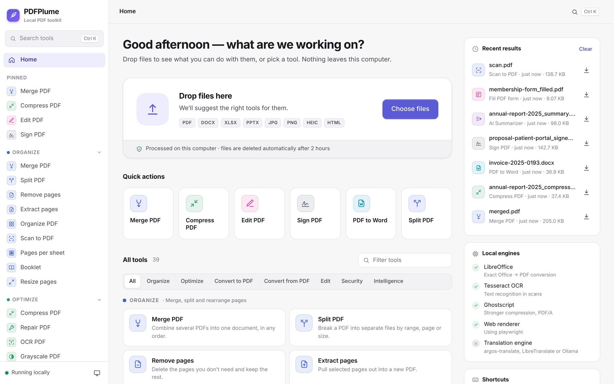
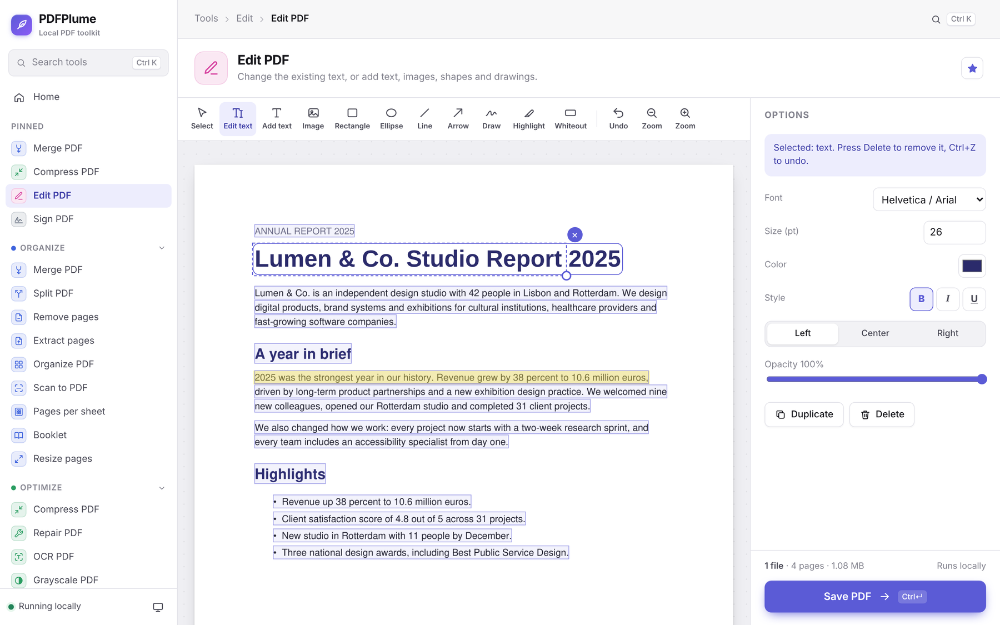
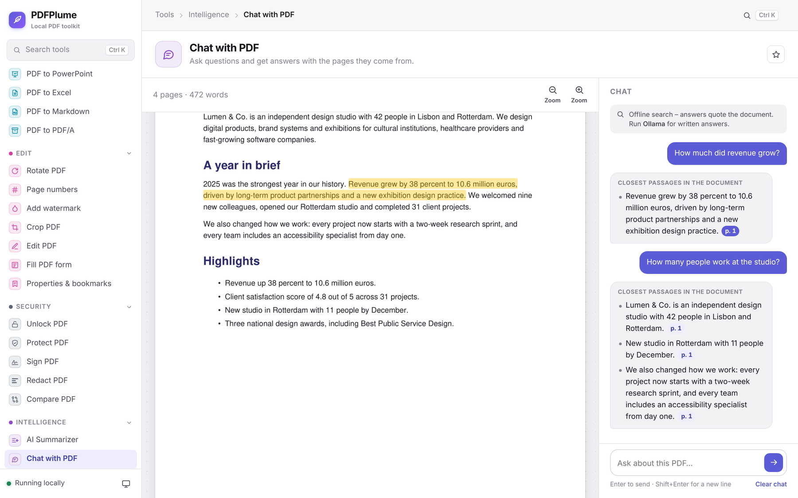
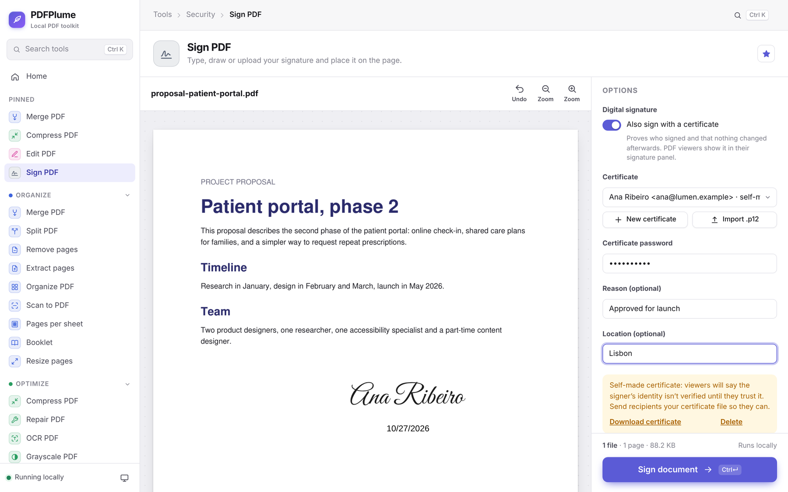
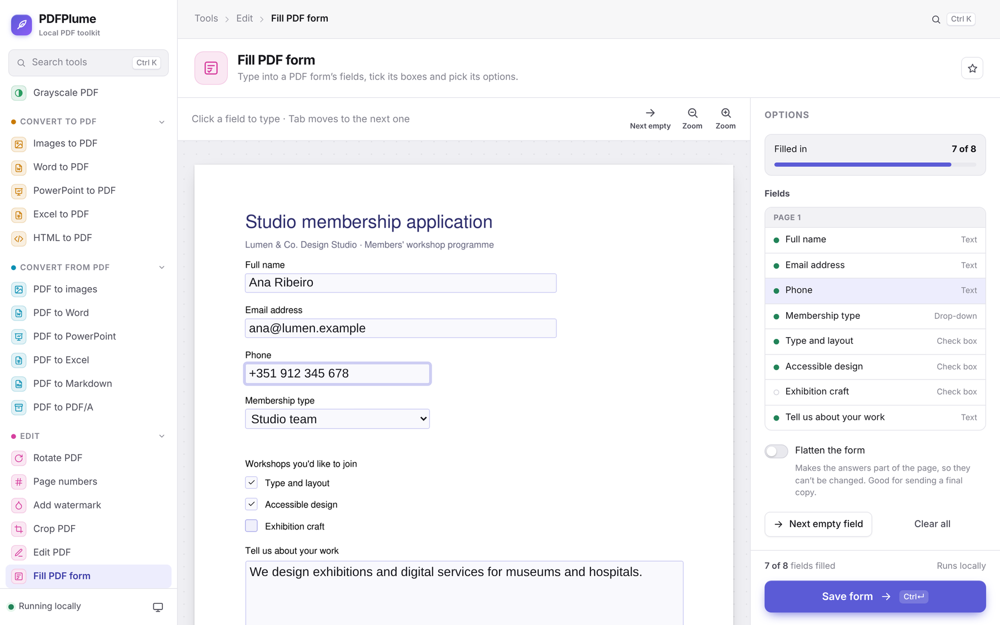
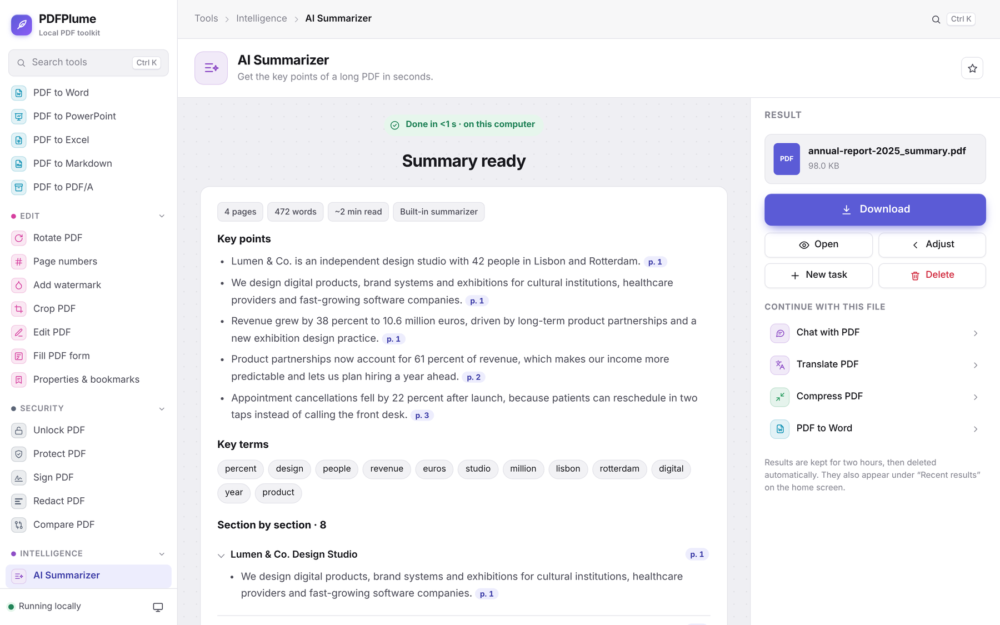
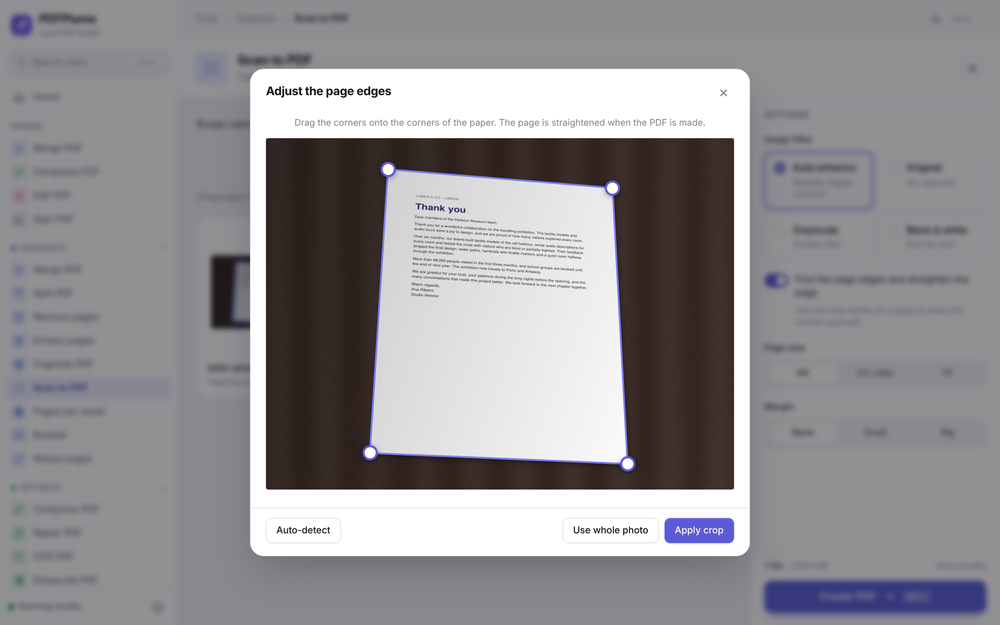
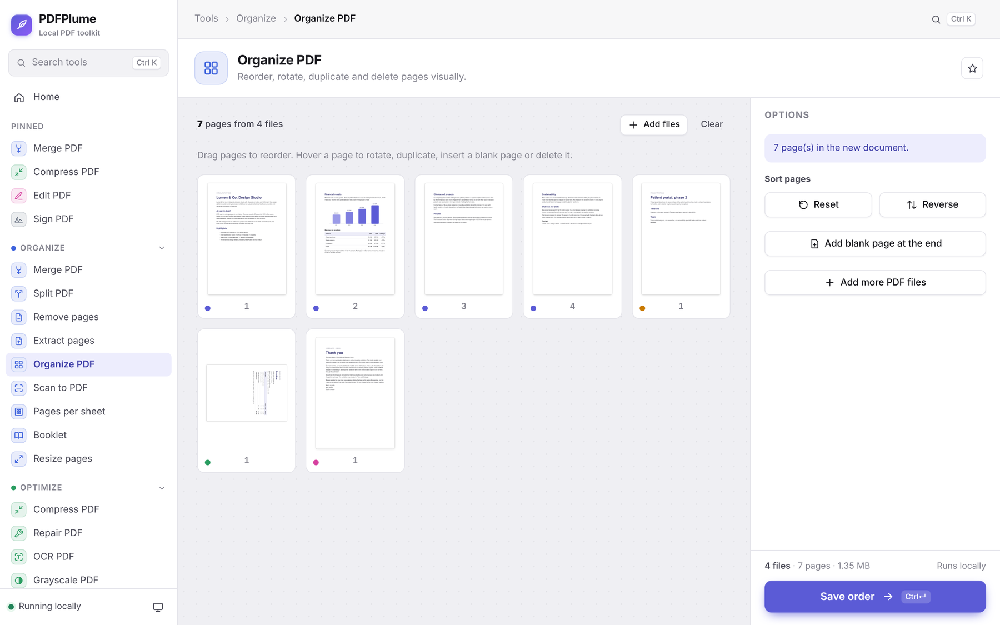
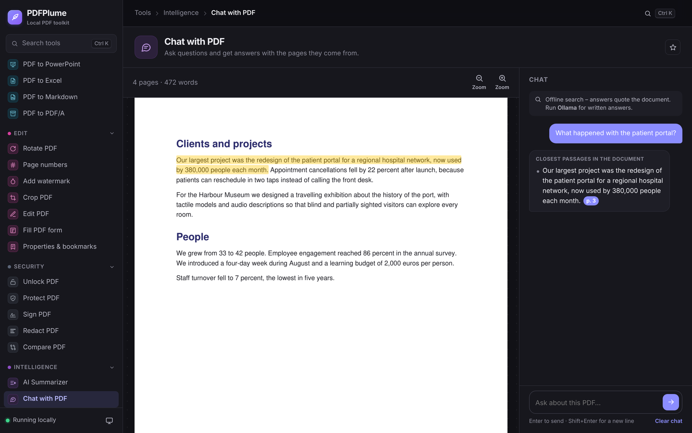
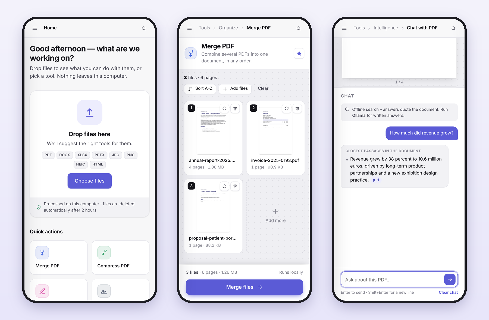

# PDFPlume – a private PDF toolkit that runs on your own computer

PDFPlume bundles **39 PDF tools** in one calm, local app: merge, split, compress,
convert, edit, fill forms, sign (also with real certificates), redact, compare,
summarize, chat with a PDF and more. There is no
account and no upload limit, and nothing is sent to the internet. Files live in
a temporary folder and are deleted automatically after two hours (or right
away with *Delete*).

   



## A quick look

<table>
  <tr>
    <td><br>
      <b>Edit the PDF's own text</b> – click any line to retype or delete it, then add highlights, shapes, images or drawings.</td>
    <td><br>
      <b>Chat with your PDF</b> – every answer cites its page; click the citation to see the exact sentence highlighted.</td>
  </tr>
  <tr>
    <td><br>
      <b>Sign</b> – type, draw or upload a signature, and optionally add a real digital signature with your own certificate.</td>
    <td><br>
      <b>Fill in forms</b> – type straight into the form's fields, tick boxes and pick options; flatten it when you're done.</td>
  </tr>
  <tr>
    <td><br>
      <b>Summarize</b> – key points with page references, key terms and a section-by-section summary.</td>
    <td><br>
      <b>Scan to PDF</b> – PDFPlume finds the page in your photo and straightens it; drag the corners to fine-tune.</td>
  </tr>
  <tr>
    <td><br>
      <b>Organize pages</b> – drag pages from several PDFs into order, rotate, duplicate, delete or add blank pages.</td>
    <td><br>
      <b>Light or dark</b> – follows your system, or pick one in the sidebar.</td>
  </tr>
</table>



<sub>Screenshots use fictional sample documents.</sub>

## Using PDFPlume

* **Start from your files** – drop any PDF, Office document, image or HTML file
  on the home screen and PDFPlume suggests the tools that fit (e.g. two PDFs →
  *Merge* or *Compare*).
* **Or jump straight to a tool** – press <kbd>⌘ K</kbd> / <kbd>Ctrl K</kbd>
  (or <kbd>/</kbd>) and type what you want to do: “shrink”, “sign”, “docx” …
* **One workspace per tool** – files on the canvas, options in the panel on the
  right, and the result appears in the same place. <kbd>⌘ ↵</kbd> runs the tool,
  <kbd>⌘ O</kbd> adds files.
* **Chain tools** – every result offers *Continue with this file* (merge, then
  compress, then protect …).
* **Pin your favourites** with the star next to a tool's name; they stay at the
  top of the sidebar.
* **Recent results** for the last two hours are listed on the home screen.
* **Paste files** with <kbd>⌘ V</kbd> / <kbd>Ctrl V</kbd> – a screenshot or a
  file copied in Finder / Explorer lands straight in the tool.
* **Cancel** a long task with the *Cancel* button or <kbd>Esc</kbd>; nothing is
  changed.
* **Install it as an app** – in Chrome or Edge use the *Install app* button at
  the bottom of the sidebar (or the install icon in the address bar) to get
  PDFPlume in its own window, in the Dock / Start menu.
* **Light, dark or system theme** – toggle in the bottom-left corner.
* Works on phones and tablets, too.

## Tools

| Category | Tools |
|---|---|
| **Organize** | Merge PDF · Split PDF (custom / fixed ranges, selected pages, by size) · Remove pages · Extract pages · Organize PDF (drag & drop pages, rotate, duplicate, insert blank pages, combine several PDFs) · Scan to PDF (webcam / phone camera or photos; finds the page edges and straightens the page, adjustable corners, auto-enhance, black & white) · Pages per sheet (2, 4, 6, 8, 9 or 16-up) · Booklet (saddle-stitch imposition for folding) · Resize pages (A4 ⇄ Letter, A3, A5, Legal or custom; scale or keep) |
| **Optimize** | Compress PDF (strong / balanced / light, or *under a file size* such as 2 MB) · Repair PDF · OCR PDF (searchable text layer, multiple languages) · Grayscale PDF |
| **Convert to PDF** | Images (JPG, PNG, HEIC/HEIF from iPhones, GIF, BMP, TIFF, WebP) to PDF · Word to PDF · PowerPoint to PDF · Excel/CSV to PDF · HTML to PDF (any web address or .html file) |
| **Convert from PDF** | PDF to images (pages or embedded pictures) · PDF to Word · PDF to PowerPoint (editable text) · PDF to Excel (table detection) · PDF to Markdown / plain text (for notes apps and AI tools) · PDF to PDF/A (1b, 2b, 3b) |
| **Edit** | Rotate PDF (files or single pages) · Page numbers · Add watermark (text or image, tiled, transparency, rotation, layer) · Crop PDF · Edit PDF (change or delete the document's own text, add text, images, shapes, lines, arrows, freehand drawing, highlight, whiteout) · Fill PDF form (text fields, check boxes, radio buttons, drop-downs and lists right on the page; optional flattening) · Properties & bookmarks (title, author, subject, keywords; a bookmark tree, with suggestions from the headings) |
| **Security** | Unlock PDF · Protect PDF (AES-256, permissions) · Sign PDF (type / draw / upload a signature, initials, name, date, text, stamp – and optionally a real **digital signature** with a certificate) · Redact PDF (true removal of areas, words and patterns such as e-mails, phone numbers, IBANs) · Compare PDF (side-by-side text diff or visual overlay) |
| **Intelligence** | AI Summarizer (key points with page references, section by section; offline, or written by a local LLM via Ollama) · Chat with PDF (ask questions, answers cite and highlight the pages) · Translate PDF (keeps the layout; local engines) |

Also: live previews for watermarks and page numbers, password-protected input
files, batch processing (results are zipped), adding files from a link.

## Quick start

### Desktop app (no Python needed)

Download the app for your computer from the repository's **Actions → Desktop
app** run (or from a release), unzip it and start it:

* **macOS** – `PDFPlume.app`. The app isn't signed by Apple, so the first time
  right-click it → *Open* → *Open*.
* **Windows** – `PDFPlume\PDFPlume.exe`. If SmartScreen appears: *More info* → *Run anyway*.
* **Linux** – `PDFPlume/PDFPlume`.

A small PDFPlume window shows the address and opens your browser; close the window
to quit. The app keeps its files in `~/Library/Application Support/PDFPlume`
(macOS), `%LOCALAPPDATA%\PDFPlume` (Windows) or `~/.local/share/PDFPlume` (Linux).
LibreOffice, Tesseract and Ghostscript are still separate, optional installs
(see [Optional engines](#optional-engines)).

To build the app yourself: `packaging/build.sh` (macOS / Linux) or
`packaging\build.bat` (Windows) – the result is in `dist/`. Run the
*Desktop app* workflow on GitHub (Actions tab → *Run workflow*, or push a tag
such as `v2.1.0`) to build all three at once.

### From source

You need **Python 3.10 or newer** ([download](https://www.python.org/downloads/)).

**Windows** – double-click `start.bat`

**macOS / Linux**

```bash
./start.sh
```

The script creates a virtual environment, installs the dependencies (first run
only) and opens <http://localhost:8765> in your browser.

### Manual installation

```bash
python3 -m venv .venv
source .venv/bin/activate          # Windows: .venv\Scripts\activate
pip install -r requirements.txt
python run.py                      # then open http://localhost:8765
```

`python run.py --help` shows the options (`--host`, `--port`, `--open`).

### Docker (everything included)

The image contains LibreOffice, Ghostscript, Tesseract (6 languages) and
Chromium, so every tool works at full quality:

```bash
docker compose up --build          # then open http://localhost:8765
```

## Optional engines

Every tool works with the Python packages alone. A few tools get better when
one of these free programs is installed – PDFPlume detects them automatically at
start-up (the console shows which ones were found) and tells you in the UI when
something is missing.

| Program | Used by | Without it | Install |
|---|---|---|---|
| **LibreOffice** | Word / PowerPoint / Excel to PDF | Built-in converter for .docx, .pptx, .xlsx, .csv, .txt (simpler layout); .doc/.ppt/.xls/.odt need LibreOffice | Windows: `winget install TheDocumentFoundation.LibreOffice` · macOS: `brew install --cask libreoffice` · Linux: `sudo apt install libreoffice` |
| **Tesseract OCR** | OCR PDF, OCR option of the converters, scanned documents in Summarize/Translate | OCR is unavailable | Windows: `winget install UB-Mannheim.TesseractOCR` · macOS: `brew install tesseract tesseract-lang` · Linux: `sudo apt install tesseract-ocr tesseract-ocr-eng` (+ `tesseract-ocr-fra` etc.) |
| **Ghostscript** | Compress PDF (stronger), PDF to PDF/A (font embedding, colour conversion), Repair (last resort) | MuPDF-based compression and basic PDF/A | Windows: `winget install ArtifexSoftware.GhostScript` · macOS: `brew install ghostscript` · Linux: `sudo apt install ghostscript` |
| **Chrome / Chromium / Edge** | HTML to PDF (JavaScript, modern CSS) | Basic HTML renderer without JavaScript | Install the browser – it is found automatically. Optionally `pip install playwright` for page size / margin control |

If a program is installed in an unusual place, point PDFPlume to it with
`PDFPLUME_SOFFICE`, `PDFPLUME_TESSERACT`, `PDFPLUME_GHOSTSCRIPT` or `PDFPLUME_CHROME`.

### Translate PDF

Translation needs a translation engine. Pick one:

* **argos-translate** (fully offline, large download):
  ```bash
  pip install argostranslate
  python -c "import argostranslate.package as p; p.update_package_index(); [x.install() for x in p.get_available_packages() if x.from_code=='en' and x.to_code=='es']"
  ```
  (repeat with the language pairs you need)
* **LibreTranslate** running locally: `docker run -p 5001:5000 libretranslate/libretranslate`, then start PDFPlume with `LIBRETRANSLATE_URL=http://localhost:5001`
* **Ollama** (local LLM): install [Ollama](https://ollama.com), run `ollama pull llama3.2` and restart PDFPlume – it is found automatically on its default address. Use `OLLAMA_URL` for another address and `OLLAMA_MODEL` to pick the model.

### Chat with PDF and the AI Summarizer

Both work without any AI model: *Chat with PDF* then answers with the
sentences of the document that match your question best (each with its page),
and the summarizer picks the most representative sentences. With
[Ollama](https://ollama.com) running (`ollama pull llama3.2`), PDFPlume switches
to written answers and summaries from your local model – still citing pages
like `[p. 4]`, still entirely on your computer. Click a page reference to jump
to the highlighted passage.

### Digital signatures

*Sign PDF → Also sign with a certificate* adds a cryptographic PAdES signature
(via [pyHanko](https://github.com/MatthiasValvekens/pyHanko)). It proves who
signed and that the file hasn't changed since – PDF viewers show it in their
signature panel. You can

* **create a certificate** in PDFPlume (kept password-protected in
  `<data dir>/certificates`), or
* **import** a `.p12` / `.pfx` from your organisation or a certificate authority.

A certificate you made yourself is "self-signed": viewers confirm the file is
unchanged but say the signer's identity isn't verified, until the recipient
trusts your certificate (*Download certificate* gives you the file to send
them; in Acrobat: *Signature panel → Trust*). Signing a PDF that is already
signed keeps the earlier signatures valid.

## Configuration

| Variable | Default | Meaning |
|---|---|---|
| `PDFPLUME_HOST` / `PDFPLUME_PORT` | `127.0.0.1` / `8765` | Address to listen on. Use `0.0.0.0` to use PDFPlume from other devices in your network |
| `PDFPLUME_DATA_DIR` | `./data` | Workspace for uploads and results (temporary) and your signing certificates (kept) |
| `PDFPLUME_FILE_TTL_MINUTES` | `120` | Files older than this are deleted |
| `PDFPLUME_MAX_UPLOAD_MB` | `1024` | Upload size limit |
| `PDFPLUME_WORKERS` | CPU count (max 4) | Parallel processing jobs |
| `LIBRETRANSLATE_URL`, `LIBRETRANSLATE_API_KEY`, `OLLAMA_URL`, `OLLAMA_MODEL` | – | Optional AI engines (see above) |
| `PDFPLUME_OLLAMA_AUTODETECT` | `1` | Set to `0` to stop looking for Ollama on `localhost:11434` |

> The camera in *Scan to PDF* needs a secure page: use it on `http://localhost`
> (or put PDFPlume behind HTTPS when using it from your phone).

## Troubleshooting

* **"Access to localhost was denied – HTTP ERROR 403" (macOS)** – another
  program answered instead of PDFPlume. On macOS 12+ the *AirPlay Receiver* uses
  port 5000. PDFPlume uses port 8765 by default and automatically moves to the next
  free port if the one you asked for is taken – always open the address printed
  in the terminal. You can also pick a port yourself: `./start.sh --port 9000`.
* **A tool says an engine is missing** – install the program from the
  [Optional engines](#optional-engines) table and restart PDFPlume.

## How it works

```
browser (vanilla JS, no CDN)  ──►  Flask + Waitress  ──►  worker processes
  static/  home, tool pages,        /api/upload, thumbnails,   pdfplume/tools/*.py
  page grid, editor, signer,        /api/process/<tool>,       PyMuPDF, pikepdf,
  redaction, comparison             /api/jobs/<id> (polling)   pdf2docx, LibreOffice …
```

* `pdfplume/server.py` – HTTP API and page routes
* `pdfplume/jobs.py` – runs each task in a separate process (MuPDF is not thread safe) and reports progress; tasks can be cancelled
* `pdfplume/tools/` – one module per category; every tool is a function registered with `@tool("slug")`
* `pdfplume/engines.py` – detection of the optional programs
* `pdfplume/chat.py`, `pdfplume/llm.py` – passage search and the optional Ollama connection behind *Chat with PDF*
* `pdfplume/structure.py` – heading detection (bookmark suggestions, section summaries)
* `pdfplume/scan.py` – page detection and perspective correction for *Scan to PDF* (OpenCV)
* `pdfplume/certs.py` – signing certificates and digital signatures (pyHanko)
* `desktop.py`, `packaging/` – the stand-alone desktop app (PyInstaller)
* `pdfplume/static/js/tools.js` – the tool catalogue (texts, colours, sidebar options)
* `pdfplume/static/js/widgets/` – the visual workspaces (page grid, split, crop, editor, sign, redact, compare, scan, form, bookmarks, chat)
* `pdfplume/static/css/style.css` – the design system (tokens, light/dark themes, components)

### API example

```bash
ID=$(curl -s -F file=@report.pdf localhost:8765/api/upload | python -c "import sys,json;print(json.load(sys.stdin)['id'])")
JOB=$(curl -s -H 'Content-Type: application/json' -d "{\"files\":[{\"id\":\"$ID\"}],\"options\":{\"level\":\"extreme\"}}" localhost:8765/api/process/compress_pdf | python -c "import sys,json;print(json.load(sys.stdin)['job_id'])")
curl -s localhost:8765/api/jobs/$JOB            # poll until "status": "done"
curl -o compressed.pdf localhost:8765/api/jobs/$JOB/download
```

## Development

```bash
pip install -r requirements-dev.txt
python -m pytest            # 115 tests covering every tool and the HTTP API
```

Tests that need LibreOffice, Tesseract, Ghostscript or Chrome are skipped when
the program is not installed; the pure-Python fallbacks are always tested.

## License

PDFPlume is free software, licensed under the
[GNU Affero General Public License v3.0](LICENSE). You may use, study, change
and share it. If you distribute PDFPlume – or let other people use a modified
version over a network – you must also offer them its source code under the
same license.

PDFPlume builds on open-source libraries, among them
[PyMuPDF](https://pymupdf.readthedocs.io/) (AGPL-3.0),
[pikepdf](https://github.com/pikepdf/pikepdf) (MPL-2.0),
[pyHanko](https://github.com/MatthiasValvekens/pyHanko) (MIT), pdf2docx (MIT),
OpenCV (Apache-2.0) and Flask (BSD-3-Clause). The bundled handwriting fonts
(Great Vibes, Dancing Script, Sacramento, Caveat) are licensed under the SIL
Open Font License – see `pdfplume/static/fonts/`.
